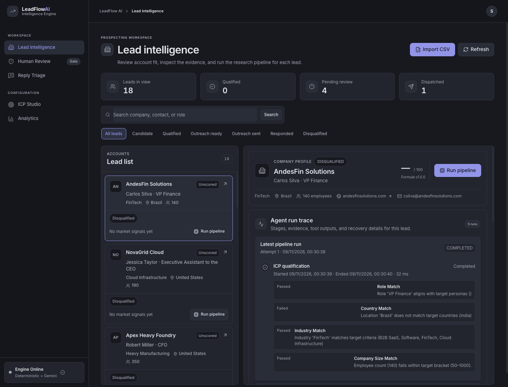
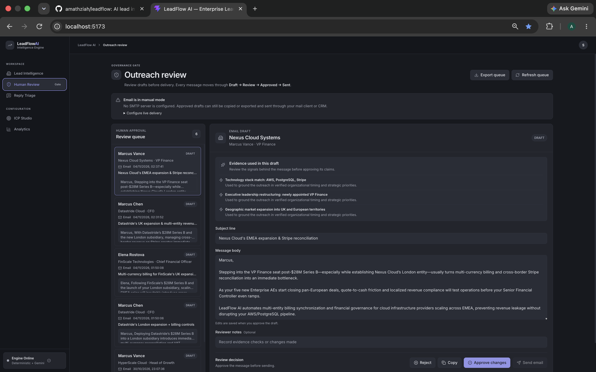
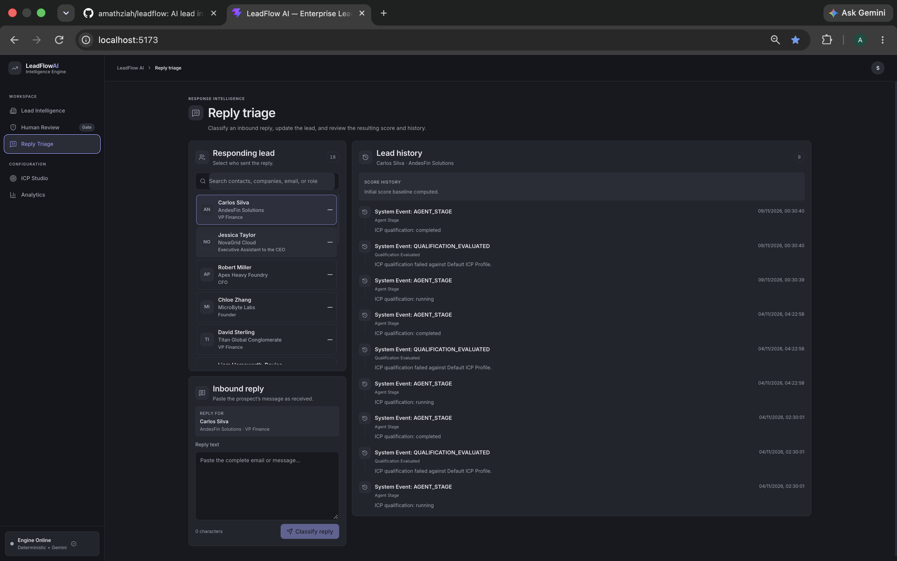
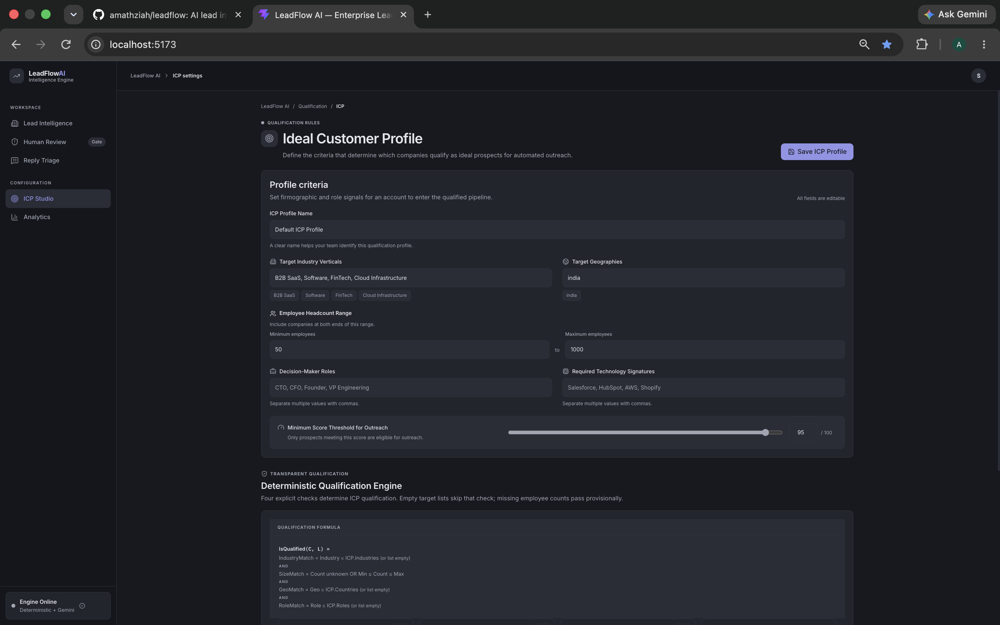
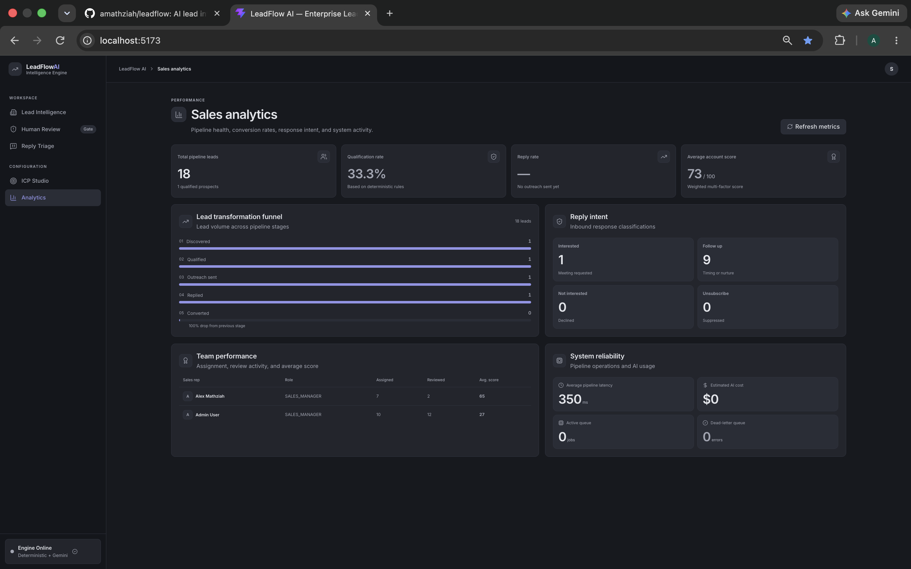
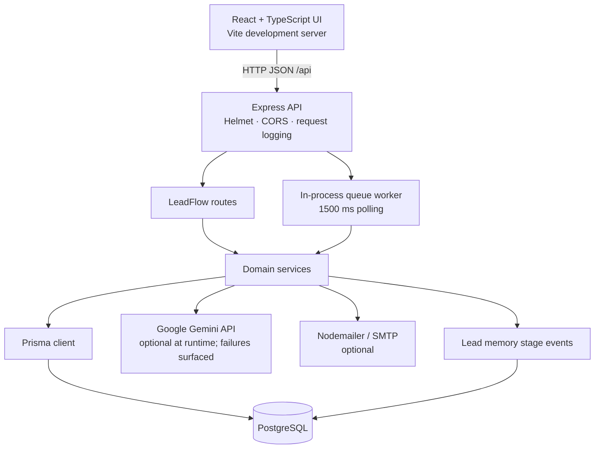

# LeadFlow AI

LeadFlow turns a company list into researched, ICP-qualified prospects and evidence-grounded outreach drafts. A person reviews each draft before delivery. Qualification and scoring use deterministic code; AI is used for research synthesis, enrichment, signal detection, and copy generation, with provenance and fallbacks exposed in the product.

## Product workflow

```mermaid
flowchart LR
    Import[CSV / JSON import] --> Candidate[Candidate lead + company]
    Candidate --> Queue[Persistent job queue]
    Queue --> Qualify[Deterministic ICP qualification]
    Qualify -->|Fail| Stop[Disqualified; run stops]
    Qualify -->|Pass| Enrich[Company enrichment]
    Enrich --> Signals[Market signal detection]
    Signals --> Score[Deterministic multi-factor score]
    Score --> Research[Tool-augmented research synthesis]
    Research --> Draft[Signal-grounded outreach draft]
    Draft --> Review[Human review]
    Review -->|Reject| Rejected[Rejected]
    Review -->|Approve| Approved[Approved]
    Approved -->|SMTP configured| Send[SMTP delivery]
    Approved -->|SMTP unavailable| Manual[Copy or export]
    Send --> Reply[Reply triage]
    Reply --> Memory[Persist response + update lead + rescore]
```



The full pipeline is asynchronous. A lead that fails deterministic ICP checks stops before AI enrichment and research. Drafts enter a review queue; the server refuses delivery unless a draft is approved, and only records it as sent after the SMTP transport accepts it.

## Screenshots

### Lead intelligence



### Outreach review



### Reply triage



### ICP Studio



### Sales analytics



## Architecture at a glance



### Repository map

```text
frontend/
  src/App.tsx                    App shell, sidebar, tab navigation and page selection
  src/pages/                     Lead pipeline, ICP Studio, analytics, review and reply triage
  src/components/                Shared page components and AgentRunTrace
  src/services/api.ts            Typed fetch client and API data shapes
  src/index.css                  Global theme, layout and component styles
  vite.config.ts                 Vite + React + Tailwind integration

backend/
  src/server.ts                  Express setup, database bootstrap, worker lifecycle and shutdown
  src/routes/index.ts            Health route and route mounting
  src/routes/leadflowRoutes.ts   HTTP endpoints and request/response orchestration
  src/services/                  Import, ICP, qualification, enrichment, scoring, review, etc.
  src/services/ai/                Gemini client and research agent
  src/db/prisma.ts               Prisma connection lifecycle
  src/config/env.ts              Environment parsing and validation with Zod
  src/middleware/                Request logging and centralized error handling
  src/browser/                   Browser setup and visual grounding utilities
  prisma/schema.prisma           PostgreSQL schema, enums and relations
  evals/                          Deterministic and model-assisted evaluation harnesses
  scripts/                        Manual AI/browser diagnostics

docs/                             Incident postmortem and supporting notes
docker-compose.yml                Local PostgreSQL service
sample_leads.csv                  Example import data
```

## Frontend architecture

The frontend is a React 19 single-page application written in TypeScript and served by Vite. `App.tsx` owns the application shell, sidebar collapse state, backend health indicator, and page navigation. Navigation currently uses local React state rather than a URL router, so pages are selected as tabs and do not have independent route URLs.

| UI page | Responsibility |
| --- | --- |
| Lead Intelligence (`LeadPipelinePage`) | Import and search leads, view lead/company details, run pipeline actions and inspect the agent trace |
| Outreach Review (`OutreachReviewPage`) | Review evidence, edit drafts, approve/reject, copy/export, and send approved email |
| Reply Triage (`ReplyTriagePage`) | Submit an inbound response for classification and view the resulting lead update |
| ICP Studio (`IcpSettingsPage`) | Configure active qualification criteria |
| Sales Analytics (`SalesAnalyticsPage`) | View manager funnel, outreach and queue metrics |

`src/services/api.ts` is the shared typed API client. It uses `VITE_API_BASE_URL` or defaults to `http://localhost:4000/api`. Failed network and HTTP requests throw errors for pages to display; they are not silently converted into empty results. Shared UI elements live under `src/components/ui`. `AgentRunTrace` renders stage events and queue-run information from the lead detail response. The global Soft Dark theme and layout rules are in `src/index.css`.

## Backend architecture

The backend is a Node.js 20+ Express service using TypeScript, Prisma, and PostgreSQL. `server.ts` configures Helmet, CORS, JSON parsing, request logging, API routes, 404 handling, and the error handler. During startup it connects to PostgreSQL, ensures a default organization/ICP context exists, and starts the queue worker. Graceful shutdown stops the worker and disconnects Prisma.

Routes validate and shape HTTP input, then delegate domain work to services. The main service boundaries are:

| Service | Responsibility |
| --- | --- |
| `discoveryService` | Parse CSV/imported records and persist company/lead candidates |
| `icpService` | Create, list, activate and update ICP profiles |
| `qualificationService` | Deterministic, explainable ICP checks and qualification status |
| `enrichmentService` | Enrich company profile fields and record provenance/confidence |
| `signalEngine` | Detect and persist company buying signals |
| `scoringService` | Calculate and persist versioned, itemized lead scores |
| `ai/researchAgentService` | Gather profile, signal, history and model-assisted company research; validate dossier output |
| `personalizationService` | Generate an outreach draft and retain generation provenance/fallback details |
| `reviewService` / `emailService` | Enforce approval state and deliver via SMTP |
| `responseAnalysisService` | Classify a submitted reply, update lead state/memory and rescore |
| `analyticsService` | Build lead 360 and manager dashboard data |
| `queueService` | Persist jobs, execute pipeline stages, retry failures and expose queue metrics |
| `leadMemoryService` | Return timeline and agent trace events for a lead |

### Pipeline job and agent trace

`QueueService` is an in-process polling worker backed by PostgreSQL, not a separate broker. It checks for due `WAITING` jobs every 1.5 seconds, marks one active, and executes the job. Idempotency keys prevent duplicate active/recently completed work. Failed jobs are retried with bounded exponential backoff and jitter; jobs that exhaust `maxAttempts` move to `DLQ` with the last error recorded.

For `PROCESS_LEAD_PIPELINE`, the worker records a `LeadMemoryItem` before and after each stage (or on failure):

1. ICP qualification (deterministic; a disqualified lead stops here)
2. Company enrichment
3. Market signal detection
4. Lead scoring
5. Research synthesis
6. Outreach drafting

Trace metadata can include run ID, stage status, duration, qualification checks/reasons, score breakdown, tools used, signals, model/fallback provenance, generated message ID, and error details. Lead detail combines these trace events with related queue runs, qualification history, enrichments, signals, score, research dossier, and outreach. Trace writes are best-effort so an observability write failure does not itself fail a pipeline stage.

The research service is tool-augmented synthesis, not an autonomous unbounded ReAct loop. It gathers structured company profile, stored signals, lead/company history, and a model-assisted company profile lookup, then makes a bounded synthesis call. Output is checked against a Zod schema; malformed output or a model error produces a deterministic fallback with a recorded reason. Model aliases are configurable through `GEMINI_FAST_MODEL` and `GEMINI_DEEP_MODEL`.

### Deterministic and model-assisted work

| Deterministic application logic | Model-assisted work |
| --- | --- |
| ICP criteria checks and disqualification reasons | Company enrichment where configured data is missing |
| Versioned scoring formula and factor breakdown | Signal suggestions/detection |
| Queue idempotency, retry and state transitions | Research dossier synthesis |
| Human approval requirement and send-before-commit behavior | Outreach draft generation |
| Reply classification heuristics and persistence | — |

The model is not treated as an authoritative source of truth. Signals and generated company research should be verified by a reviewer; a source URL or model-generated statement is not proof that the event is accurate or current. Missing credentials or AI errors can cause a deterministic fallback in services that support one. The UI and trace expose the fallback provenance instead of treating it as model success.

## Data model

The authoritative schema is [`backend/prisma/schema.prisma`](backend/prisma/schema.prisma). The model is relational, with JSON fields for variable evidence and explanation payloads. Important entity groups:

| Group | Models | Purpose |
| --- | --- | --- |
| Workspace and targeting | `Organization`, `User`, `IcpProfile`, `Campaign` | Workspace context, user/reviewer references, ICP criteria and campaign grouping |
| Prospect intelligence | `Company`, `Lead`, `EnrichmentRecord`, `CompanySignal` | Company/contact facts, provenance-tracked enrichment and market signals |
| Decisions and evidence | `LeadScore`, `ResearchDossier`, `LeadMemoryItem`, `EvidenceSource` | Explainable scoring, research output, longitudinal history and evidence records |
| Outreach and response | `OutreachMessage`, `InboundResponse`, `ChatMessage` | Draft lifecycle, reviewed delivery, response classification and conversation history |
| Execution and audit | `JobQueueItem`, `Workflow`, `ExecutionLog`, `AuditLog` | Queue execution, legacy workflow telemetry and audit records |

Relations cascade where child records belong to a company or lead. Companies are unique by `(orgId, domain)`. Scores and memory preserve historical results; `Lead.leadScore` is also a cached current score used for list ordering. The schema contains organization and user concepts, but the current API has no authentication or authorization middleware and generally operates on a seeded default workspace. Treat this as a single-workspace development application; the schema alone does not provide tenant isolation.

### Outreach delivery state

Outreach states are represented by the `OutreachState` enum: `DRAFT`, `REVIEW`, `APPROVED`, `SENT`, `REJECTED`, and `FAILED`. The review service permits dispatch only for an approved message. Delivery uses Nodemailer over SMTP. State changes to sent only after the mail transport returns acceptance; failed or unconfigured SMTP does not create a phantom sent record. When SMTP is not configured, approved messages can be copied or exported manually.

## HTTP API

The API is mounted under `/api`. `routes/index.ts` mounts the LeadFlow router both at `/api` and `/api/leadflow` for compatibility, so the paths below also work with the `/leadflow` prefix. Successful responses generally use `{ success: true, data }`.

| Method | Path | Purpose |
| --- | --- | --- |
| `GET` | `/health` or `/api/health` | Service health check |
| `POST` | `/api/import/csv` | Parse/import CSV; optionally enqueue newly created leads with `autoProcess` |
| `POST` | `/api/import/json` | Import company/contact objects; optionally enqueue processing |
| `GET`, `POST`, `PUT` | `/api/icp`, `/api/icp/:id` | List/read active ICP, create, update profile |
| `GET` | `/api/leads` | Search/filter leads by status, text and minimum score |
| `GET` | `/api/leads/:id/360` | Lead, score, signals, dossier, history and agent trace |
| `GET` | `/api/leads/:id/timeline` | Lead memory timeline |
| `POST` | `/api/leads/:id/qualify` | Evaluate ICP rules |
| `POST` | `/api/leads/:id/enrich` | Enrich company and detect signals |
| `POST` | `/api/leads/:id/score` | Recalculate lead score |
| `POST` | `/api/leads/:id/research` | Run research synthesis |
| `POST` | `/api/leads/:id/outreach` | Generate outreach draft |
| `POST` | `/api/leads/:id/pipeline` | Enqueue full pipeline job |
| `GET` | `/api/outreach/pending` | List drafts waiting for human review |
| `POST` | `/api/outreach/:id/approve` | Save edited draft and approve it |
| `POST` | `/api/outreach/:id/reject` | Reject draft with reason |
| `POST` | `/api/outreach/:id/dispatch` | Send an approved email over SMTP |
| `POST` | `/api/leads/:id/response` | Classify and persist an inbound response; update and rescore lead |
| `GET` | `/api/analytics/manager` | Manager funnel and outreach analytics |
| `GET` | `/api/analytics/queue` | Queue and worker metrics |
| `GET` | `/api/config/status` | Database, Gemini and SMTP configuration status (no secrets) |
| `POST` | `/api/config/smtp/verify` | Verify SMTP configuration |

## Stack and integrations

- **Frontend:** React 19, TypeScript, Vite, Tailwind CSS v4, Lucide icons.
- **Backend:** Node.js 20+, TypeScript, Express 4, Zod, Winston.
- **Persistence:** PostgreSQL 16 and Prisma 5.
- **AI:** Google Generative AI SDK for Gemini. Fast/deep model names are environment-overridable. AI-dependent services retain provenance and may use deterministic fallback behavior.
- **Email:** Nodemailer using any compatible SMTP service (Gmail app password, SES, SendGrid, Mailgun, Postmark, or another relay).
- **Browser utilities:** Playwright-based helpers exist under `backend/src/browser`; they are not a continuously running browser automation platform.
- **Optional storage:** Supabase configuration is for screenshot/log storage; without it screenshots can be stored locally.
- **Queue:** PostgreSQL-backed in-process polling worker. No Redis or external queue broker is required.

## Local development

Requirements: Node.js 20+, Docker with Compose (or an existing PostgreSQL database), and optionally a Gemini API key for model-assisted stages.

```bash
git clone <repository-url>
cd lead-flow
docker compose up -d --wait

cd backend
npm install
cp .env.example .env
# Set DATABASE_URL and, if desired, GEMINI_API_KEY in backend/.env
npx prisma db push
npm run dev
```

In another terminal:

```bash
cd frontend
npm install
npm run dev
```

The frontend defaults to `http://localhost:4000/api` for the backend. Set `VITE_API_BASE_URL` to change it. The Vite app is normally available at `http://localhost:5173`; the backend defaults to port `4000`.

### Environment settings

Backend configuration is parsed in `backend/src/config/env.ts`; the documented template is [`backend/.env.example`](backend/.env.example).

| Variable | Use |
| --- | --- |
| `DATABASE_URL` | PostgreSQL connection string (required) |
| `PORT`, `NODE_ENV` | HTTP port and runtime mode |
| `GEMINI_API_KEY` | Enables Gemini-backed enrichment, signals, research and outreach |
| `GEMINI_FAST_MODEL`, `GEMINI_DEEP_MODEL` | Override model aliases |
| `LLM_PROVIDER` | Template advertises provider selection; current `llmClient` uses Gemini when a usable key is present and service-level fallbacks on errors |
| `SMTP_HOST`, `SMTP_PORT`, `SMTP_SECURE`, `SMTP_USER`, `SMTP_PASSWORD`, `SMTP_FROM` | Optional email delivery configuration |
| `SUPABASE_URL`, `SUPABASE_ANON_KEY`, `SUPABASE_SERVICE_ROLE_KEY`, bucket settings | Optional screenshot/log storage |
| `BROWSER_MODE`, `CHROME_CDP_PORT` | Browser helper configuration |

To enable real email sending, configure all required SMTP values and verify with `POST /api/config/smtp/verify`. Without SMTP, manual copy/export remains available and dispatch fails closed. Check `GET /api/config/status` for non-secret integration status.

## Evaluation and quality checks

Run the evaluation harness with:

```bash
cd backend
npm run evals
```

Tier 1 exercises deterministic ICP qualification as a pure function and requires no database, network, or model key. Tier 2 evaluates generated outreach and requires a database with signal-bearing leads plus a Gemini key; unavailable prerequisites are reported as skipped. The latest checked-in run is summarized in [`backend/evals/REPORT.md`](backend/evals/REPORT.md). Its 20 authored qualification cases are regression coverage, not a measure of production-wide classification quality. Outreach grounding checks lexical overlap with evidence and does not prove that the source claims are true.

For more on a past silent model outage and the provenance/evaluation fixes, see [`docs/POSTMORTEM-silent-model-outage.md`](docs/POSTMORTEM-silent-model-outage.md).

## Current boundaries

- There is no login or API authentication. Do not expose this development application publicly without adding access control and tenant scoping.
- The queue worker runs inside the API process. It is suitable for a single-node setup, not horizontally scaled worker deployment.
- Signal detection and the company research lookup are model-assisted; the system does not subscribe to a guaranteed live news feed or independently verify every source.
- LinkedIn automation is not implemented. LinkedIn-channel drafts can be handled manually; automated dispatch supports email over SMTP only.
- Browser automation helpers and legacy workflow/chat schema are present, but are not the primary lead-processing path described above.

## License

[MIT](LICENSE)
